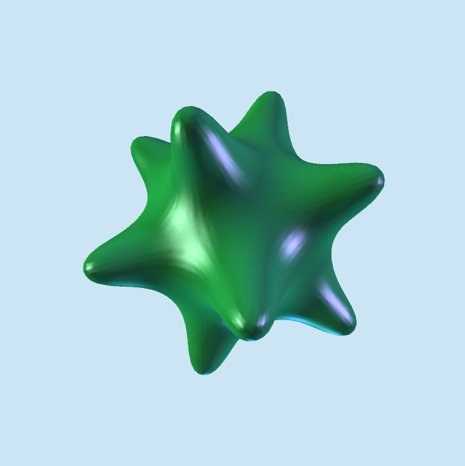
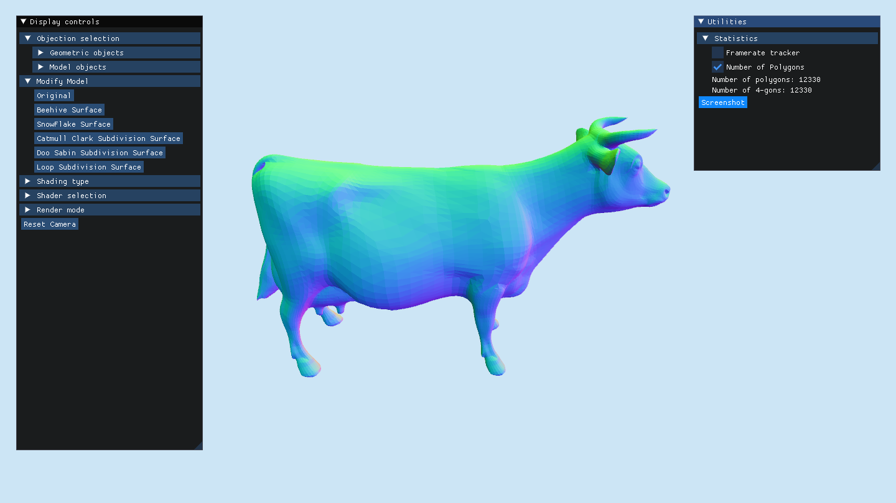
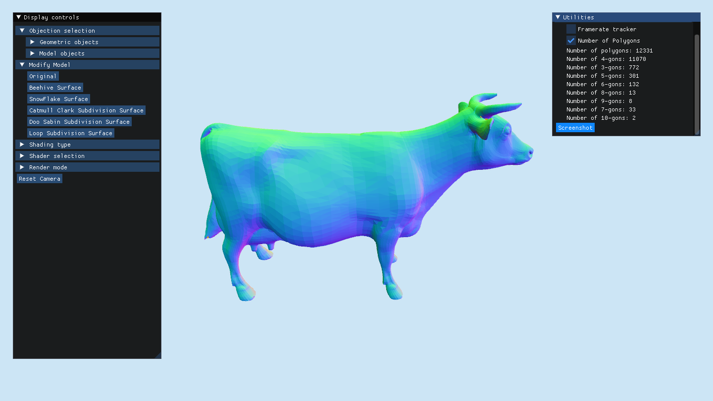
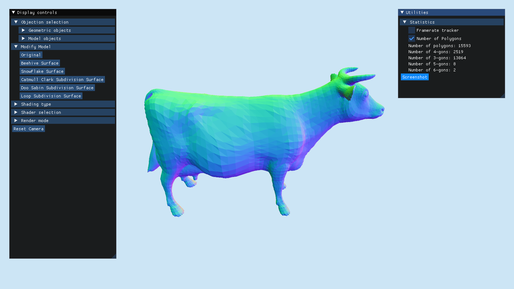

# Model-Modifier



[](https://github.com/jasonlmfong/Model-Modifier/blob/main/LICENSE)
[](https://github.com/jasonlmfong/Model-Modifier/actions/workflows/ci.yml)

Model-Modifier is my implementation of various mesh modification algorithms, built on top of [OreRenderer](https://github.com/Ore-Software/OreRenderer).

## Features

- [x] Mesh modification algorithms
  - [x] Subdivision surface
    - [x] [Catmull-Clark](https://en.wikipedia.org/wiki/Catmull%E2%80%93Clark_subdivision_surface)
    - [x] [Doo-Sabin](https://en.wikipedia.org/wiki/Doo%E2%80%93Sabin_subdivision_surface)
    - [x] [Loop](https://en.wikipedia.org/wiki/Loop_subdivision_surface)
  - [x] Simplification surface
    - [x] [QEM](https://www.cs.cmu.edu/~./garland/Papers/quadrics.pdf)
    - [x] [Line QEM](https://www.dgp.toronto.edu/~hsuehtil/pdf/lineQuadric.pdf)

## Image Gallery

</details>

<details>
<summary>Comparison of different subdivision surface algorithms</summary>
  


> Cow mesh, Normal shader, not smoothened



> Cow mesh, Normal shader, smoothened 1 time with Catmull-Clark subdivision



> Cow mesh, Normal shader, smoothened 1 time with Doo-Sabin subdivision



> Cow mesh, Normal shader, smoothened 1 time with Loop subdivision

</details>

## Dependencies

- `GLFW`
- `GLM`
- `Dear ImGui`

## Build

Ensure that python and jinja 2 are installed as GLAD requires them.
Create the solution file by running:

```{cmd}
mkdir build
cd build
cmake ..
```

Open the solution file however you like.
